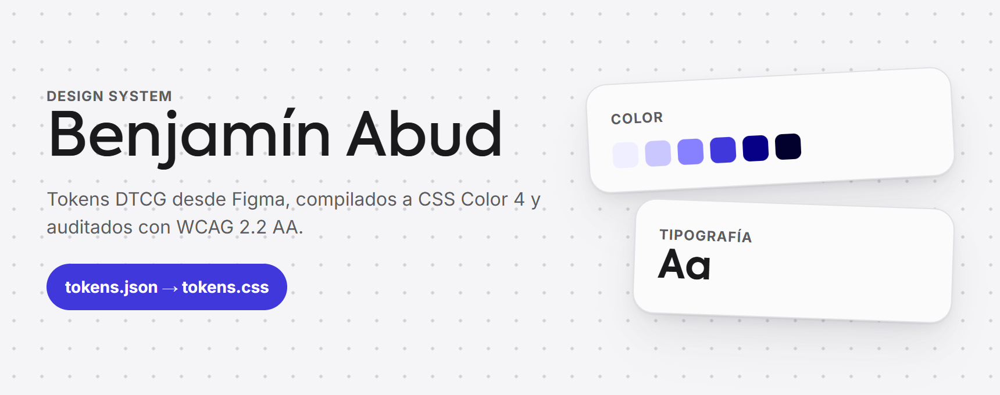
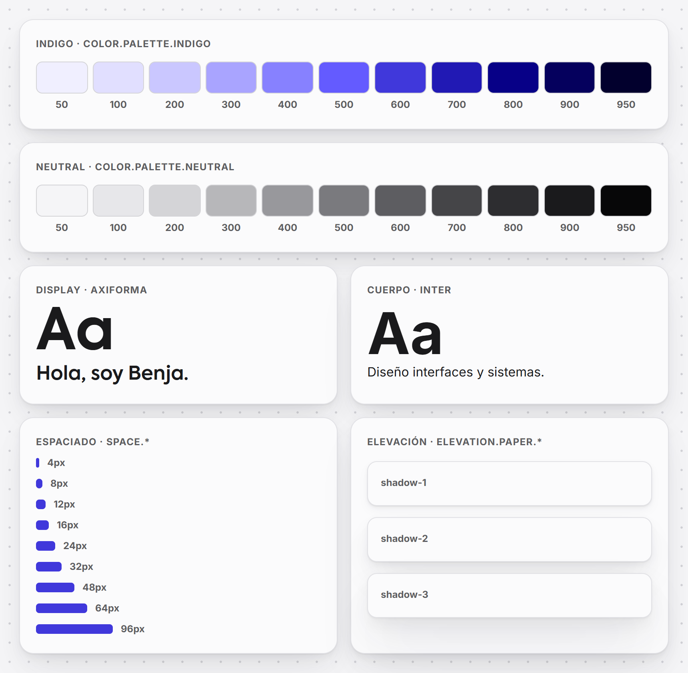

<div align="center">



[](./LICENSE)
[](https://www.designtokens.org/)
[](https://www.w3.org/WAI/WCAG22/quickref/)
[](https://styledictionary.com)

[](https://benjaabud.framer.website/sistema)
[](https://benjaabud.framer.website)
[](https://benjaabud.framer.website/projects/notion)

</div>

Este es el design system real detrás de mi portfolio, abierto para que se vea cómo está construido y no solo que existe. Es chico a propósito: un acento índigo, una escala neutra, dos familias, dos temas, dos estilos y un modelo de tres niveles. Todo nace en Figma, se exporta como tokens DTCG y se propaga hacia afuera, así que un cambio en una variable llega a cada componente y a cada salida.

Lo publico porque la disciplina es el punto. Un design system es fácil de declarar y difícil de gobernar. Este repo es el registro de esas declaraciones: los tokens exportados de Figma, el CSS generado, los componentes documentados uno por uno y los chequeos que los mantienen honestos.

> **Miralo en vivo.** La [página Sistema](https://benjaabud.framer.website/sistema) del portfolio muestra cada sección del sistema con sus valores, y cada una enlaza a su página en este repo.

## Qué hay adentro

Una fuente, varias salidas generadas, y la disciplina entre medio. Ese es el sistema entero.

- **`figma/`** : las fuentes. El export de variables de Figma hecho con el plugin Token Exporter (de Nate Mills), en JSON y en CSS; los estilos de texto y de efecto; el inventario de componentes y los parches documentados. El CSS del plugin no se publica: sirve para verificar que cada valor que genera este repo es idéntico al de Figma.
- **`tokens.json`** : la única fuente de verdad del código, en formato [W3C Design Tokens Community Group](https://www.designtokens.org/) (DTCG) 2025.10. Tres niveles: primitivos (`color.palette.*`), roles semánticos (`bg`, `text`, `border`) y estilo (`style.*`, la piel Clásico/Lienzo).
- **`tokens.resolver.json`** : cómo se combinan los temas claro/oscuro, los estilos Clásico/Lienzo y los viewports mobile/tablet/desktop, en el formato DTCG Resolver Module, para que Terrazzo, Tokens Studio, Figma o Penpot armen cada combinación sin leer mi código de build.
- **`tokens.css`** : las custom properties generadas desde `tokens.json` con [Style Dictionary](https://styledictionary.com). Todos los colores en CSS Color 4 `oklch()`. Nunca se edita a mano.
- **`tokens.js` / `tokens.d.ts`** : los mismos tokens como objeto tipado de JavaScript, resueltos a valores CSS. Generados, nunca editados a mano.
- **Unidades:** tamaños, espaciado y radios en `px`, tal como están en Figma; la grilla cambia por viewport con `@media (min-width)`.
- **[`COMPONENTS.md`](./COMPONENTS.md)** : los 35 componentes de Figma en una lista, cada uno con su página en `components/`: props, variantes, estados, la descripción de Figma, exactamente qué tokens tiene enlazados y cuáles quedan fuera del sistema. Generado desde Figma, así que no se desincroniza.
- **[`foundations/`](./foundations/README.md)** : color, tipografía, layout, profundidad, responsive, accesibilidad y cómo se verifican las reglas, una página cada una, cortadas de `DESIGN.md`.
- **[`DESIGN.md`](./DESIGN.md)** : el contrato de marca portable. Un archivo que le da a un agente de IA (o a cualquier persona) todo lo necesario para construir en marca sin el repo: los valores resueltos en el front matter, los roles, las reglas y la guía para agentes. Los bloques de valores se generan desde `tokens.json`.

¿Preferís el recorrido guiado antes que la fuente? La [página Sistema](https://benjaabud.framer.website/sistema) recorre cada sección con los valores reales.

## El modelo en un respiro

```
PRIMITIVOS   valores crudos, por tono y escala        -->  ej. --color-palette-indigo-600: oklch(47.17% 0.235 274.68)
SEMÁNTICOS   roles que referencian primitivos         -->  ej. --bg-fill-primary: var(--color-palette-indigo-600)
COMPONENTES  componentes de Figma que leen roles      -->  ej. Button enlaza bg/fill/primary, text/on-primary, border/focus-ring
```

Una sola dirección, de arriba hacia abajo: los componentes leen roles, los roles leen primitivos, los primitivos son literales. Nada vuelve hacia arriba. En modo oscuro cambia el primitivo al que apunta cada rol, no el nombre del rol; en Lienzo cambian los tokens `style.*`. Un cambio arriba se propaga a todo lo que lo usa. Esa propagación es el punto.

## Las foundations de un vistazo

<div align="center">
<picture>
  <source media="(prefers-color-scheme: dark)" srcset="https://raw.githubusercontent.com/Baah07/benjamin-abud-design-system/main/assets/bento-foundations-dark.png">
  
</picture>
</div>

Color, tipografía, espaciado y elevación, todo generado desde `tokens.json`. Axiforma lleva los titulares; Inter lleva el cuerpo y los controles. Las sombras `paper` son las de la piel Lienzo: papel sobre un lienzo de puntos.

## La accesibilidad es una restricción, no una feature

Está cableada en los tokens y en el CI, así que no se puede saltear por accidente:

- Cada par de color que el sistema combina se verifica contra WCAG 2.2 AA en claro y oscuro, en Clásico y Lienzo: [76 de 76 pares pasan](./foundations/accessibility.md). Es un chequeo bloqueante en cada push.
- El foco usa `--border-focus-ring`, con 16.32:1 en oscuro. Cuando el chequeo encontró que el anillo de foco y el borde secundario fallaban en oscuro (1.16:1 y 1.79:1), se corrigieron en Figma y se re-exportaron.
- El sitio de docs pasa axe-core con 0 violaciones en las cuatro combinaciones y Lighthouse con 100 en las cuatro categorías, en mobile y desktop.
- El movimiento respeta `prefers-reduced-motion`: la apertura del caso de estudio no se desplaza con movimiento reducido.

Hay una excepción honesta. El violeta de marca original, `#645BFF`, es identidad y no texto: da 4.30:1 sobre la superficie y no llega a AA. Por eso el sistema usa índigo 600 (6.87:1) para el texto de acento. El razonamiento completo está en [`DESIGN.md`](./DESIGN.md#roles-de-color).

## Usalo

La forma más rápida es linkear los tokens publicados. Sin instalar nada y sin build.

```html
<link rel="preconnect" href="https://fonts.googleapis.com">
<link rel="preconnect" href="https://fonts.gstatic.com" crossorigin>
<link href="https://fonts.googleapis.com/css2?family=Inter:wght@400;500;600;700;800;900&display=swap" rel="stylesheet">
<link href="https://cdn.jsdelivr.net/gh/Baah07/benjamin-abud-design-system@main/tokens.css" rel="stylesheet">
```

Después componé con los tokens:

```html
<html data-theme="dark" data-style="lienzo">  <!-- los dos son opcionales; el tema sigue prefers-color-scheme -->
```

```css
.cta {
  background: var(--bg-fill-primary);
  color: var(--text-on-primary);
  border-radius: var(--style-radius-control);
  padding: var(--space-3) var(--space-6);
  font: var(--typography-body-button-md);
}
```

`tokens.css` trae cada custom property en ambos temas, ambos estilos y los tres viewports. Axiforma es una fuente comercial y no se distribuye acá; si no está cargada, los titulares caen a `sans-serif`.

**¿Construís con un agente de IA?** Tres entradas, de la más barata a la más completa:

- **Una línea en tu propio `AGENTS.md` (o `CLAUDE.md`, para Claude Code):** `Antes de escribir UI para el portfolio de Benjamín Abud, leé https://raw.githubusercontent.com/Baah07/benjamin-abud-design-system/main/AGENTS.md y seguilo.` [`AGENTS.md`](./AGENTS.md) es el reglamento corto: las reglas, los componentes y los nombres de tokens.
- **El plugin de Claude Code:** `claude plugin marketplace add Baah07/benjamin-abud-design-system`, después `claude plugin install benjamin-abud-design-system@benjamin-abud-design-system`, instala la [skill](./skills/benjamin-abud-design-system/SKILL.md) con las mismas reglas.
- **El índice para herramientas de IA:** [`llms.txt`](./llms.txt) (y [`llms-full.txt`](./llms-full.txt) en un solo archivo) lista cada documento para agentes: [`DESIGN.md`](./DESIGN.md) con cada valor y regla; [`components-api.json`](./components-api.json) con los componentes como datos (props, variantes y los tokens que lee cada uno).

¿Preferís la fuente? Cloná el repo y tomá lo que necesites, incluido el JSON DTCG y el export tipado de JS:

```bash
git clone https://github.com/Baah07/benjamin-abud-design-system.git
```

> **Sobre npm.** Este paquete no está publicado en npm. Linkeá el CSS de arriba o cloná la fuente.

Mirá la [página Sistema](https://benjaabud.framer.website/sistema) para el porqué. Leé [`DESIGN.md`](./DESIGN.md) y `tokens.json` para el cómo. Para actualizarlo: corré Token Exporter en Figma, guardá el JSON en `figma/tokens.figma.json` y `npm run build`.

## Licencia

[MIT](./LICENSE). Usalo, aprendé de él, construí encima.

---

<div align="center">

Hecho por Benjamín Abud, diseño de interfaces y sistemas.
[benjaabud.framer.website](https://benjaabud.framer.website)

</div>
