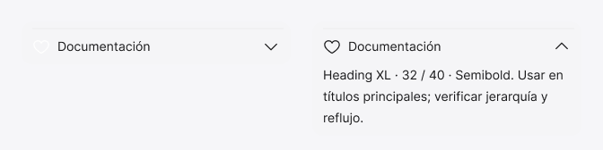

<!-- Generated by scripts/build-pages.mjs from figma/components.json. Do not edit by hand: change Figma, re-export, run `npm run build`. -->

# Accordeon

**Level:** Molecule · **Variants:** 2 · **Figma:** [open component](https://www.figma.com/design/FvaEDyROUUsM8ntHj8C9f8/?node-id=462-690)

## Description

S02 · Pieza nativa reutilizable. Instancias anidadas y variables del sistema. Geometría local del wireframe; no API web.

## Properties

| Property | Type | Values / default |
| --- | --- | --- |
| Title | Text | `Documentación` |
| Content | Text | `Heading XL · 32 / 40 · Semibold. Usar en títulos principales; verificar jerarquía y reflujo.` |
| Show icon left | Boolean | `true` |
| Show Icon right | Boolean | `true` |
| Show Divider | Boolean | `true` |
| State | Variant | `Closed` · `Open` |

## Tokens

Styled only with tokens from [`tokens.css`](../tokens.css). See [foundations](../foundations/README.md).

## Preview

