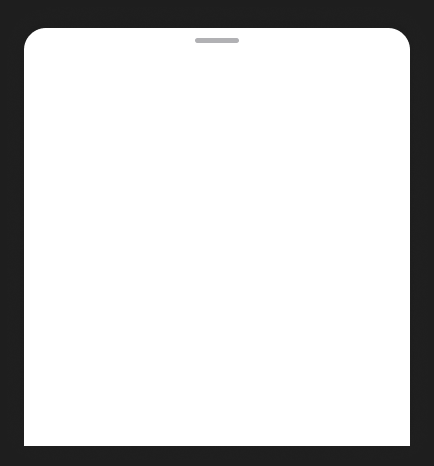

<!-- Generated by scripts/build-pages.mjs from figma/components.json. Do not edit by hand: change Figma, re-export, run `npm run build`. -->

# Bottom sheet

**Level:** Molecule · **Variants:** 1 · **Figma:** [open component](https://www.figma.com/design/FvaEDyROUUsM8ntHj8C9f8/?node-id=1064-3)

## Description

Contenedor vacío basado en la referencia de Framer guardada el 26/10/2026. Superficie blanca, radios superiores 22 px y base recta. Redimensionar ancho y alto según contexto. Content es un slot vacío para insertar instancias; Show handle controla el tirador. Sin título, cierre, paneles, controles ni prototipos. Los 22 px preservan la geometría específica de la referencia; colores y espacios usan variables existentes.

## Properties

| Property | Type | Values / default |
| --- | --- | --- |
| Show handle | Boolean | `true` |
| Content | Slot | — |

## Tokens

Styled only with tokens from [`tokens.css`](../tokens.css). See [foundations](../foundations/README.md).

## Preview

