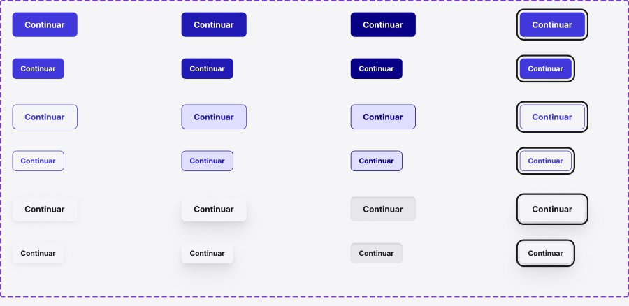

<!-- Generated by scripts/build-pages.mjs from figma/components.json. Do not edit by hand: change Figma, re-export, run `npm run build`. -->

# Button

**Level:** Atom · **Variants:** 24 · **Figma:** [open component](https://www.figma.com/design/FvaEDyROUUsM8ntHj8C9f8/?node-id=246-420)

## Description

C01 Button. Label, Variant, Size y State conservados. Show leading icon / Show trailing icon: false por defecto. Leading icon / Trailing icon: instance swap independientes dentro del auto layout, antes/después de Label. El glifo predeterminado hereda los colores semánticos del texto; iconos alternativos conservan su contrato cromático. Ampliación solicitada para S01 Header el 2026-10-26; sin nuevas variantes ni tokens.

## Properties

| Property | Type | Values / default |
| --- | --- | --- |
| Label | Text | `Continuar` |
| Show trailing icon | Boolean | `false` |
| Trailing icon | Instance swap | — |
| Show leading icon | Boolean | `false` |
| Leading icon | Instance swap | — |
| Variant | Variant | `Primary` · `Secondary` · `Tertiary` |
| Size | Variant | `MD` · `SM` |
| State | Variant | `Default` · `Hover` · `Pressed` · `Focus` |

## Related parts on the same Figma page

- Segmented
- button_icon
- Segmented control
- Segment option
- S01 / Sound control
- S01 / Menu trigger

## Tokens

Styled only with tokens from [`tokens.css`](../tokens.css). See [foundations](../foundations/README.md).

## Preview

