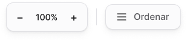

<!-- Generated by scripts/build-pages.mjs from figma/components.json. Do not edit by hand: change Figma, re-export, run `npm run build`. -->

# Canvas toolbar

**Level:** Organism · **Variants:** 1 · **Figma:** [open component](https://www.figma.com/design/FvaEDyROUUsM8ntHj8C9f8/?node-id=1189-175)

## Description

Lienzo · Herramientas del canvas (bottom-left): zoom + ordenar carpetas en grilla.

## Related parts on the same Figma page

- Canvas header

## Tokens

Styled only with tokens from [`tokens.css`](../tokens.css). See [foundations](../foundations/README.md).

## Preview

