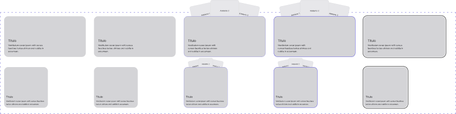

<!-- Generated by scripts/build-pages.mjs from figma/components.json. Do not edit by hand: change Figma, re-export, run `npm run build`. -->

# Card

**Level:** Molecule · **Variants:** 10 · **Figma:** [open component](https://www.figma.com/design/FvaEDyROUUsM8ntHj8C9f8/?node-id=299-77)

## Description

C03: tarjeta con imagen de fondo, título y descripción. Fuente: capturas del usuario y Framer Home/Case Notion. Framer tiene placeholders sin imagen, título y descripción ocultos; aquí visibles por pedido. Hover/Pressed propuestos (borde, sin escala). La apertura de caso corresponde a C04: override withExpandingCaseSheet, entrada 0.8 s cubic-bezier(0.87,0,0.13,1); sin desplazamiento con reduced motion. No se implementa el panel C04 en esta familia. Interactive: botón si abre panel, enlace si navega; sin acciones anidadas. Focus documenta focus-visible; Figma no certifica tabulación DOM. Actualización: hover con imagen al 105%, tres adelantos sobre el borde superior y Smart Animate 300 ms ease-out. La geometría del contenedor y sus textos no cambia.

## Properties

| Property | Type | Values / default |
| --- | --- | --- |
| Title | Text | `Titulo` |
| Description | Text | `Vestibulum curae ipsum velit cursus faucibus luctus ultrices orci cubilia in accumsan.` |
| Show description | Boolean | `true` |
| Protect text over image | Boolean | `true` |
| Size | Variant | `Desktop` · `Mobile` |
| Type | Variant | `Informative` · `Interactive` |
| State | Variant | `Default` · `Hover` · `Pressed` · `Focus` |

## Related parts on the same Figma page

- Card / Summary
- Usage row
- Token value
- Type specimen

## Tokens

Styled only with tokens from [`tokens.css`](../tokens.css). See [foundations](../foundations/README.md).

## Preview

