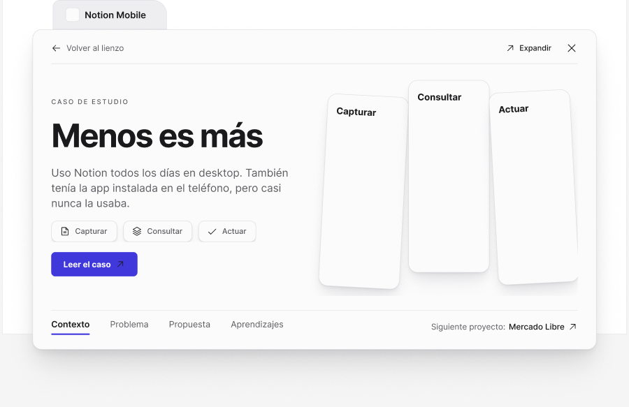

<!-- Generated by scripts/build-docs.mjs from figma/components.json, tokens.json and the Figma file. Do not edit. -->

# Case study modal

> Lienzo · Vista de caso de estudio que se abre desde una Folder.

Parte del [Design System de Benjamín Abud](../README.md). Es un componente de Figma: sus props son las propiedades del componente en Figma y sus estilos salen solo de tokens. Los tokens se linkean como muestra [Primeros pasos](../foundations/getting-started.md). Todos los componentes: [Componentes](../COMPONENTS.md).

## Cómo usarlo

**Nivel:** Organismo · **Variantes:** 1 · **Figma:** [abrir el componente](https://www.figma.com/design/FvaEDyROUUsM8ntHj8C9f8/?node-id=1190-2)

**Variante por defecto:** el componente no tiene variantes.

## Props

| Prop | Tipo | Valores permitidos | Default | Descripción |
|---|---|---|---|---|
| `Project` | Texto | Cualquier texto | `Notion Mobile` | — |
| `Title` | Texto | Cualquier texto | `Menos es más` | — |
| `Lead` | Texto | Cualquier texto | `Uso Notion todos los días en desktop. También tenía la app instalada en el teléfono, pero casi nunca la usaba.` | — |
| `Next project` | Texto | Cualquier texto | `Mercado Libre` | — |

## Descripción en Figma

- Lienzo · Vista de caso de estudio que se abre desde una Folder.
- Reemplazá "Media" con screens reales.
- Tabs: Contexto / Problema / Propuesta / Aprendizajes.

## Tokens

Todo lo que el componente tiene enlazado en Figma: variables, estilos de texto y de efecto. Valores en claro; la columna Oscuro y la nota Lienzo solo aparecen cuando el valor cambia.

| Token | Nivel | Valor | Oscuro | Para qué es |
|---|---|---|---|---|
| `--bg-fill-primary` | Semántico | `oklch(47.17% 0.235 274.68)` | `oklch(75.83% 0.129 285.16)` | Primary · Frame Tonal palettes · Light Theme · Dark Theme. Light → indigo/600 (Primitives Light). Dark → indigo/700 (Primitives Dark). Usar el mismo modo en ambas colecciones. |
| `--radius-md` | Dimensión | `8px` | — | 8 px · radio documentado en Spacing |
| `--space-2` | Dimensión | `8px` | — | space-2 = 8 px. Fuente: columna Pixels de Spacing. |
| `--space-3` | Dimensión | `12px` | — | space-3 = 12 px. Fuente: columna Pixels de Spacing. |
| `--space-6` | Dimensión | `24px` | — | space-6 = 24 px. Fuente: columna Pixels de Spacing. |
| `--style-bg-accent` | Estilo | `oklch(47.17% 0.235 274.68)` | `oklch(66.85% 0.181 282.58)` | — |
| `--style-bg-folder` | Estilo | `oklch(92.89% 0.004 288.63)` (Lienzo: `oklch(94.97% 0.003 286.35)`) | `oklch(22.01% 0.004 288.39)` | — |
| `--style-bg-paper` | Estilo | `oklch(97.08% 0.003 288.66)` (Lienzo: `oklch(98.84% 0.001 286.38)`) | `oklch(12.92% 0.003 288.42)` | — |
| `--style-border-paper` | Estilo | `oklch(87.09% 0.004 288.62)` (Lienzo: `oklch(91.09% 0.005 286.29)`) | `oklch(29.85% 0.005 288.37)` | — |
| `--style-radius-control` | Estilo | `8px` (Lienzo: `12px`) | — | — |
| `--style-radius-surface` | Estilo | `12px` (Lienzo: `18px`) | — | — |
| `--style-text-primary` | Estilo | `oklch(22.01% 0.004 288.39)` | `oklch(92.89% 0.004 288.63)` | — |
| `--style-text-secondary` | Estilo | `oklch(47.99% 0.006 288.46)` | `oklch(68.11% 0.006 288.55)` | — |
| `--elevation-paper-shadow-1` | Elevación | `0px 1px 1px 0px oklch(22.04% 0.02 284.66 / 0.06), 0px 2px 4px 0px oklch(22.04% 0.02 284.66 / 0.04), 0px 6px 12px -2px oklch(22.04% 0.02 284.66 / 0.05)` | — | — |
| `--elevation-paper-shadow-2` | Elevación | `0px 1px 1px 0px oklch(22.04% 0.02 284.66 / 0.06), 0px 4px 8px -1px oklch(22.04% 0.02 284.66 / 0.05), 0px 14px 28px -6px oklch(22.04% 0.02 284.66 / 0.08), 0px 28px 48px -12px oklch(22.04% 0.02 284.66 / 0.06)` | — | — |
| `--elevation-paper-shadow-3` | Elevación | `0px 1px 2px 0px oklch(22.04% 0.02 284.66 / 0.06), 0px 8px 16px -2px oklch(22.04% 0.02 284.66 / 0.06), 0px 24px 48px -8px oklch(22.04% 0.02 284.66 / 0.1), 0px 48px 80px -16px oklch(22.04% 0.02 284.66 / 0.08)` | — | — |

## Vista previa

## Fuente

- El sistema entero como un documento Design System Doc Spec: [benjamin-abud-design-system.dsds.yaml](https://raw.githubusercontent.com/Baah07/benjamin-abud-design-system/main/benjamin-abud-design-system.dsds.yaml), donde este componente es la entrada `case-study-modal`
- Los componentes como datos: [components-api.json](https://raw.githubusercontent.com/Baah07/benjamin-abud-design-system/main/components-api.json)
- El inventario exportado de Figma: [figma/components.json](https://raw.githubusercontent.com/Baah07/benjamin-abud-design-system/main/figma/components.json)
- Los tokens: [tokens.json](https://raw.githubusercontent.com/Baah07/benjamin-abud-design-system/main/tokens.json)
- El nodo en Figma: [Case study modal](https://www.figma.com/design/FvaEDyROUUsM8ntHj8C9f8/?node-id=1190-2)
