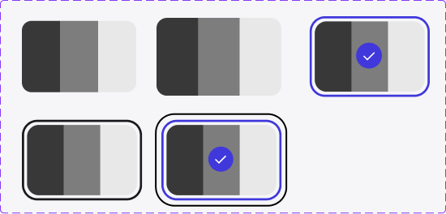

<!-- Generated by scripts/build-pages.mjs from figma/components.json. Do not edit by hand: change Figma, re-export, run `npm run build`. -->

# Choice

**Level:** Molecule · **Variants:** 5 · **Figma:** [open component](https://www.figma.com/design/FvaEDyROUUsM8ntHj8C9f8/?node-id=1023-4406)

## Description

> TODO: no description in Figma yet.

## Properties

| Property | Type | Values / default |
| --- | --- | --- |
| state | Variant | `default` · `hjover` · `selected-focus` |
| State | Variant | `Selected` · `Focus` |

## Related parts on the same Figma page

- Choice Item
- Choice group

## Tokens

Styled only with tokens from [`tokens.css`](../tokens.css). See [foundations](../foundations/README.md).

## Preview

