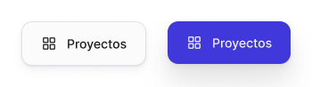

<!-- Generated by scripts/build-pages.mjs from figma/components.json. Do not edit by hand: change Figma, re-export, run `npm run build`. -->

# Dock item

**Level:** Atom · **Variants:** 2 · **Figma:** [open component](https://www.figma.com/design/FvaEDyROUUsM8ntHj8C9f8/?node-id=1188-255)

## Description

Lienzo · Ítem del dock inferior (Proyectos / Sobre mí / Sistema / Contacto). Active = sección actual.

## Properties

| Property | Type | Values / default |
| --- | --- | --- |
| Label | Text | `Proyectos` |
| Icon | Instance swap | — |
| State | Variant | `Default` · `Active` |

## Tokens

Styled only with tokens from [`tokens.css`](../tokens.css). See [foundations](../foundations/README.md).

## Preview

