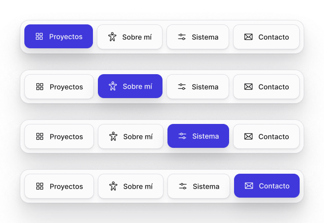

<!-- Generated by scripts/build-pages.mjs from figma/components.json. Do not edit by hand: change Figma, re-export, run `npm run build`. -->

# Dock nav

**Level:** Organism · **Variants:** 4 · **Figma:** [open component](https://www.figma.com/design/FvaEDyROUUsM8ntHj8C9f8/?node-id=1189-173)

## Description

Lienzo · Navegación principal flotante (bottom center). Active = sección actual. Fondo paper 70% + background blur.

## Properties

| Property | Type | Values / default |
| --- | --- | --- |
| Active | Variant | `Proyectos` · `Sobre mí` · `Sistema` · `Contacto` |

## Tokens

Styled only with tokens from [`tokens.css`](../tokens.css). See [foundations](../foundations/README.md).

## Preview

