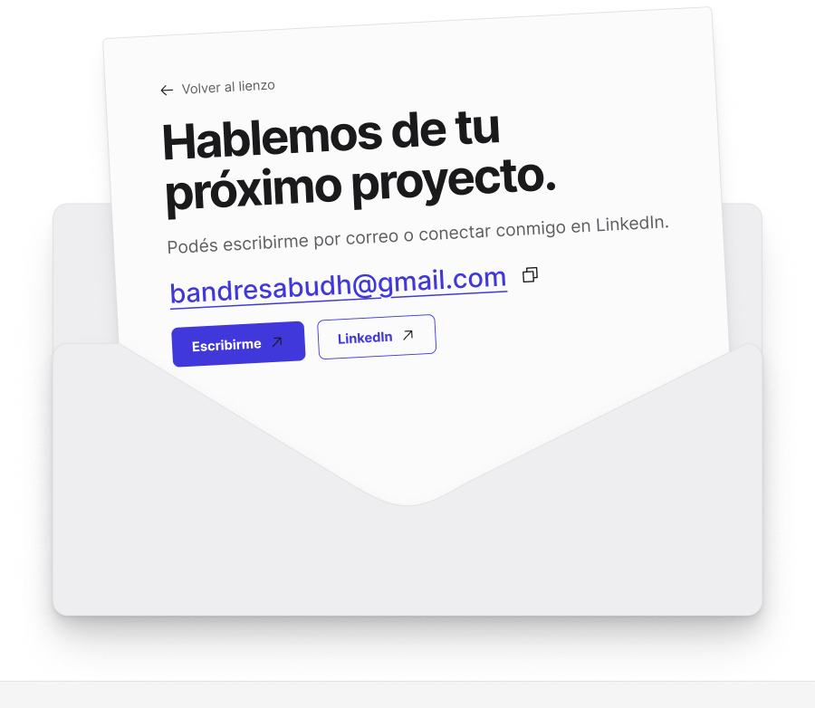

<!-- Generated by scripts/build-pages.mjs from figma/components.json. Do not edit by hand: change Figma, re-export, run `npm run build`. -->

# Envelope contact

**Level:** Organism · **Variants:** 1 · **Figma:** [open component](https://www.figma.com/design/FvaEDyROUUsM8ntHj8C9f8/?node-id=1190-97)

## Description

Lienzo · Sección Contacto: carta saliendo de un sobre. Email copiable (icono copy), CTA mailto + LinkedIn.

## Properties

| Property | Type | Values / default |
| --- | --- | --- |
| Email | Text | `bandresabudh@gmail.com` |
| Title | Text | `Hablemos de tu próximo proyecto.` |

## Tokens

Styled only with tokens from [`tokens.css`](../tokens.css). See [foundations](../foundations/README.md).

## Preview

