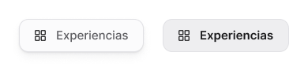

<!-- Generated by scripts/build-docs.mjs from figma/components.json, tokens.json and the Figma file. Do not edit. -->

# Filter chip

> Lienzo · Filtro de categorías del canvas (Todos / Experiencias / Componentes).

Parte del [Design System de Benjamín Abud](../README.md). Es un componente de Figma: sus props son las propiedades del componente en Figma y sus estilos salen solo de tokens. Los tokens se linkean como muestra [Primeros pasos](../foundations/getting-started.md). Todos los componentes: [Componentes](../COMPONENTS.md).

## Cómo usarlo

**Nivel:** Átomo · **Variantes:** 2 · **Figma:** [abrir el componente](https://www.figma.com/design/FvaEDyROUUsM8ntHj8C9f8/?node-id=1188-243)

**Variante por defecto:** State = `Default`

## Props

| Prop | Tipo | Valores permitidos | Default | Descripción |
|---|---|---|---|---|
| `Label` | Texto | Cualquier texto | `Experiencias` | — |
| `Icon` | Instancia | Una instancia de icono | — | — |
| `Show icon` | Booleano | `true`, `false` | `true` | — |
| `State` | Variante | `Default`, `Selected` | `Default` | — |

## Variantes

Variantes disponibles: 2, combinando `State`.

## Estados

Estados diseñados en Figma: `Default`, `Selected`.

## Descripción en Figma

- Lienzo · Filtro de categorías del canvas (Todos / Experiencias / Componentes).
- Bindeado a colección Style: cambia de piel con modo Clásico/Lienzo.

## Tokens

Todo lo que el componente tiene enlazado en Figma: variables, estilos de texto y de efecto. Valores en claro; la columna Oscuro y la nota Lienzo solo aparecen cuando el valor cambia.

| Token | Nivel | Valor | Oscuro | Para qué es |
|---|---|---|---|---|
| `--style-bg-folder` | Estilo | `oklch(92.89% 0.004 288.63)` (Lienzo: `oklch(94.97% 0.003 286.35)`) | `oklch(22.01% 0.004 288.39)` | — |
| `--style-bg-paper` | Estilo | `oklch(97.08% 0.003 288.66)` (Lienzo: `oklch(98.84% 0.001 286.38)`) | `oklch(12.92% 0.003 288.42)` | — |
| `--style-border-paper` | Estilo | `oklch(87.09% 0.004 288.62)` (Lienzo: `oklch(91.09% 0.005 286.29)`) | `oklch(29.85% 0.005 288.37)` | — |
| `--style-radius-control` | Estilo | `8px` (Lienzo: `12px`) | — | — |
| `--style-text-primary` | Estilo | `oklch(22.01% 0.004 288.39)` | `oklch(92.89% 0.004 288.63)` | — |
| `--style-text-secondary` | Estilo | `oklch(47.99% 0.006 288.46)` | `oklch(68.11% 0.006 288.55)` | — |
| `--elevation-paper-shadow-1` | Elevación | `0px 1px 1px 0px oklch(22.04% 0.02 284.66 / 0.06), 0px 2px 4px 0px oklch(22.04% 0.02 284.66 / 0.04), 0px 6px 12px -2px oklch(22.04% 0.02 284.66 / 0.05)` | — | — |

## Vista previa

## Fuente

- El sistema entero como un documento Design System Doc Spec: [benjamin-abud-design-system.dsds.yaml](https://raw.githubusercontent.com/Baah07/benjamin-abud-design-system/main/benjamin-abud-design-system.dsds.yaml), donde este componente es la entrada `filter-chip`
- Los componentes como datos: [components-api.json](https://raw.githubusercontent.com/Baah07/benjamin-abud-design-system/main/components-api.json)
- El inventario exportado de Figma: [figma/components.json](https://raw.githubusercontent.com/Baah07/benjamin-abud-design-system/main/figma/components.json)
- Los tokens: [tokens.json](https://raw.githubusercontent.com/Baah07/benjamin-abud-design-system/main/tokens.json)
- El nodo en Figma: [Filter chip](https://www.figma.com/design/FvaEDyROUUsM8ntHj8C9f8/?node-id=1188-243)
