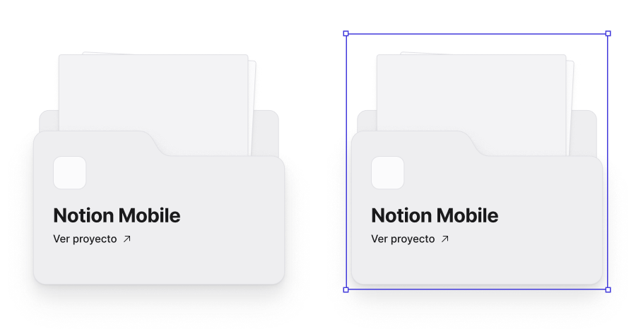

<!-- Generated by scripts/build-pages.mjs from figma/components.json. Do not edit by hand: change Figma, re-export, run `npm run build`. -->

# Folder

**Level:** Molecule · **Variants:** 2 · **Figma:** [open component](https://www.figma.com/design/FvaEDyROUUsM8ntHj8C9f8/?node-id=1189-39)

## Description

Lienzo · Carpeta de proyecto. Reemplazá el contenido de "Preview" (screens del proyecto) y "Logo". Rotación (±3°) se aplica en la instancia. Selected = foco/drag en el canvas.

## Properties

| Property | Type | Values / default |
| --- | --- | --- |
| Title | Text | `Notion Mobile` |
| Description | Text | `Productividad para equipos.` |
| Show description | Boolean | `false` |
| CTA | Text | `Ver proyecto` |
| State | Variant | `Default` · `Selected` |

## Tokens

Styled only with tokens from [`tokens.css`](../tokens.css). See [foundations](../foundations/README.md).

## Preview

