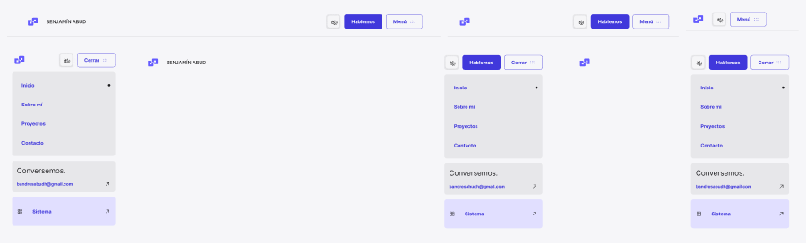

<!-- Generated by scripts/build-pages.mjs from figma/components.json. Do not edit by hand: change Figma, re-export, run `npm run build`. -->

# Header

**Level:** Organism · **Variants:** 6 · **Figma:** [open component](https://www.figma.com/design/FvaEDyROUUsM8ntHj8C9f8/?node-id=333-235)

## Description

Organism. Static visual structures by Viewport and Menu. Shared Logo, Button, Link, navigation cards and controls. Configure exposed nested properties. No prototype actions or duplicate Motion variants.

## Properties

| Property | Type | Values / default |
| --- | --- | --- |
| Show CTA | Boolean | `true` |
| Viewport | Variant | `Desktop` · `Tablet` · `Mobile` |
| Menu | Variant | `Closed` · `Open` |

## Tokens

Styled only with tokens from [`tokens.css`](../tokens.css). See [foundations](../foundations/README.md).

## Preview

