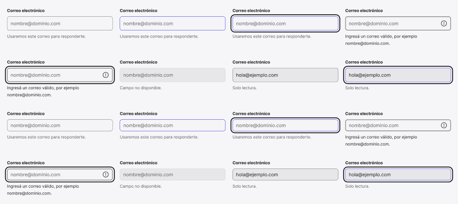

<!-- Generated by scripts/build-pages.mjs from figma/components.json. Do not edit by hand: change Figma, re-export, run `npm run build`. -->

# Input Field

**Level:** Atom · **Variants:** 16 · **Figma:** [open component](https://www.figma.com/design/FvaEDyROUUsM8ntHj8C9f8/?node-id=315-18)

## Description

Campo completo: Label + instancia C07 / Input + ayuda o error. Mostrar etiqueta es opcional en Figma; en web siempre requiere nombre accesible. Editá el Input anidado para icono intercambiable, prefijo, sufijo y contenido Empty/Filled. Conserva estados de teclado y solo lectura. Foundations del portfolio; sin colores externos.

## Properties

| Property | Type | Values / default |
| --- | --- | --- |
| Label | Text | `Correo electrónico` |
| Helper | Text | `Usaremos este correo para responderte.` |
| Error message | Text | `Ingresá un correo válido, por ejemplo nombre@dominio.com.` |
| Required | Boolean | `false` |
| Show helper | Boolean | `true` |
| Show label | Boolean | `true` |
| Size | Variant | `MD` · `SM` |
| State | Variant | `Default` · `Hover` · `Focus` · `Error` · `Error focus` · `Disabled` · `Read-only` · `Read-only focus` |

## Related parts on the same Figma page

- Property row
- Setting row

## Tokens

Styled only with tokens from [`tokens.css`](../tokens.css). See [foundations](../foundations/README.md).

## Preview

