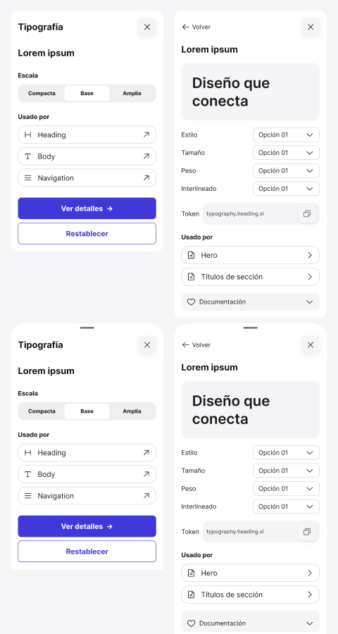

<!-- Generated by scripts/build-docs.mjs from figma/components.json, tokens.json and the Figma file. Do not edit. -->

# Inspector

> S02 · Pieza nativa reutilizable.

Parte del [Design System de Benjamín Abud](../README.md). Es un componente de Figma: sus props son las propiedades del componente en Figma y sus estilos salen solo de tokens. Los tokens se linkean como muestra [Primeros pasos](../foundations/getting-started.md). Todos los componentes: [Componentes](../COMPONENTS.md).

## Cómo usarlo

**Nivel:** Organismo · **Variantes:** 4 · **Figma:** [abrir el componente](https://www.figma.com/design/FvaEDyROUUsM8ntHj8C9f8/?node-id=462-1152)

**Variante por defecto:** Presentation = `Sidebar`, View = `Overview`

## Props

| Prop | Tipo | Valores permitidos | Default | Descripción |
|---|---|---|---|---|
| `Presentation` | Variante | `Sidebar`, `Bottom sheet` | `Sidebar` | — |
| `View` | Variante | `Overview`, `Detail` | `Overview` | — |

## Variantes

Variantes disponibles: 4, combinando `Presentation`, `View`.

- **Presentation:** `Sidebar`, `Bottom sheet`
- **View:** `Overview`, `Detail`

## Descripción en Figma

- S02 · Pieza nativa reutilizable.
- Instancias anidadas y variables del sistema.
- Geometría local del wireframe; no API web.

## Tokens

Todo lo que el componente tiene enlazado en Figma: variables, estilos de texto y de efecto. Valores en claro; la columna Oscuro y la nota Lienzo solo aparecen cuando el valor cambia.

| Token | Nivel | Valor | Oscuro | Para qué es |
|---|---|---|---|---|
| `--border-outline` | Semántico | `oklch(58.1% 0.006 288.52)` | — | Outline · Frame Tonal palettes · Light Theme · Dark Theme. Light → neutral/500 (Primitives Light). Dark → neutral/500 (Primitives Dark). Usar el mismo modo en ambas colecciones. |
| `--radius-full` | Dimensión | `9999px` | — | 9999 px · radio documentado en Spacing |
| `--radius-none` | Dimensión | `0px` | — | 0 px · radio documentado en Spacing |
| `--radius-xl` | Dimensión | `16px` | — | 16 px · radio documentado en Spacing |
| `--size-32` | Dimensión | `32px` | — | 32 px · escala base de Spacing |
| `--space-2` | Dimensión | `8px` | — | space-2 = 8 px. Fuente: columna Pixels de Spacing. |
| `--space-4` | Dimensión | `16px` | — | space-4 = 16 px. Fuente: columna Pixels de Spacing. |
| `--space-6` | Dimensión | `24px` | — | space-6 = 24 px. Fuente: columna Pixels de Spacing. |

### Variables fuera del sistema

- `s02/surface/panel`

Estas variables están enlazadas en Figma pero no pertenecen a ninguna colección exportada. Hay que reemplazarlas por tokens del sistema.

## Vista previa

## Fuente

- El sistema entero como un documento Design System Doc Spec: [benjamin-abud-design-system.dsds.yaml](https://raw.githubusercontent.com/Baah07/benjamin-abud-design-system/main/benjamin-abud-design-system.dsds.yaml), donde este componente es la entrada `inspector`
- Los componentes como datos: [components-api.json](https://raw.githubusercontent.com/Baah07/benjamin-abud-design-system/main/components-api.json)
- El inventario exportado de Figma: [figma/components.json](https://raw.githubusercontent.com/Baah07/benjamin-abud-design-system/main/figma/components.json)
- Los tokens: [tokens.json](https://raw.githubusercontent.com/Baah07/benjamin-abud-design-system/main/tokens.json)
- El nodo en Figma: [Inspector](https://www.figma.com/design/FvaEDyROUUsM8ntHj8C9f8/?node-id=462-1152)
