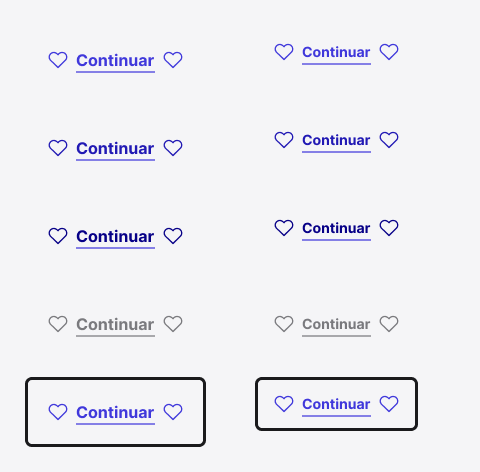

<!-- Generated by scripts/build-pages.mjs from figma/components.json. Do not edit by hand: change Figma, re-export, run `npm run build`. -->

# Link

**Level:** Atom · **Variants:** 10 · **Figma:** [open component](https://www.figma.com/design/FvaEDyROUUsM8ntHj8C9f8/?node-id=275-179)

## Description

Enlaces de navegación. MD 56 px y SM 40 px. Colores y tipografía de foundations. Texto e iconos configurables.

## Properties

| Property | Type | Values / default |
| --- | --- | --- |
| Show underline | Boolean | `true` |
| Leading icon | Boolean | `true` |
| Label | Text | `Continuar` |
| Trailing icon | Boolean | `true` |
| Size | Variant | `MD` · `SM` |
| State | Variant | `Default` · `Hover` · `Pressed` · `Disabled` · `Focus` |

## Tokens

Styled only with tokens from [`tokens.css`](../tokens.css). See [foundations](../foundations/README.md).

## Preview

