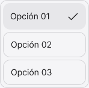

<!-- Generated by scripts/build-pages.mjs from figma/components.json. Do not edit by hand: change Figma, re-export, run `npm run build`. -->

# Menu

**Level:** Molecule · **Variants:** 1 · **Figma:** [open component](https://www.figma.com/design/FvaEDyROUUsM8ntHj8C9f8/?node-id=1010-3302)

## Description

Molecule. Options is a native content slot: add/remove linked Dropdown / Option instances. Labels and visual selection are configured on each option. No value-specific variants or prototype actions.

## Related parts on the same Figma page

- Dropdown
- Menu Item
- field

## Tokens

Styled only with tokens from [`tokens.css`](../tokens.css). See [foundations](../foundations/README.md).

## Preview

