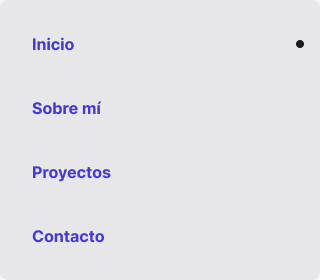

<!-- Generated by scripts/build-pages.mjs from figma/components.json. Do not edit by hand: change Figma, re-export, run `npm run build`. -->

# Navigation card

**Level:** Molecule · **Variants:** 1 · **Figma:** [open component](https://www.figma.com/design/FvaEDyROUUsM8ntHj8C9f8/?node-id=557-1271)

## Description

Navegación principal de Home: Inicio, Sobre mí, Proyectos y Contacto. Cuatro instancias de Navigation item; Inicio activo.

## Related parts on the same Figma page

- Navigation item
- Contact card
- S01 / System card
- Rail item

## Tokens

Styled only with tokens from [`tokens.css`](../tokens.css). See [foundations](../foundations/README.md).

## Preview

