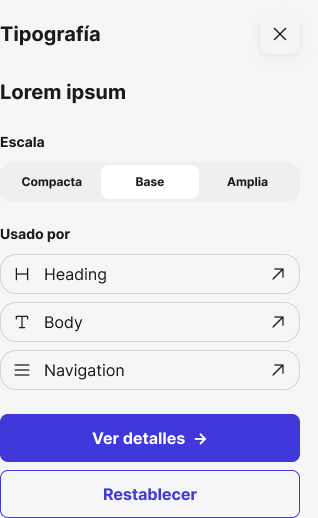

<!-- Generated by scripts/build-docs.mjs from figma/components.json, tokens.json and the Figma file. Do not edit. -->

# Panel content

> Organism example made of shared atoms and molecules.

Parte del [Design System de Benjamín Abud](../README.md). Es un componente de Figma: sus props son las propiedades del componente en Figma y sus estilos salen solo de tokens. Los tokens se linkean como muestra [Primeros pasos](../foundations/getting-started.md). Todos los componentes: [Componentes](../COMPONENTS.md).

## Cómo usarlo

**Nivel:** Organismo · **Variantes:** 1 · **Figma:** [abrir el componente](https://www.figma.com/design/FvaEDyROUUsM8ntHj8C9f8/?node-id=462-691)

**Variante por defecto:** el componente no tiene variantes.

## Props

| Prop | Tipo | Valores permitidos | Default | Descripción |
|---|---|---|---|---|
| `Subtitle` | Texto | Cualquier texto | `Lorem ipsum` | — |

## Descripción en Figma

- Organism example made of shared atoms and molecules.
- Text is editable sample content.
- No role-specific masters or runtime state.
- Exposed nested properties configure each piece.

## Partes relacionadas

Otros componentes en la misma página de Figma:

- Panel content / Detail
- Panel header
- System / Header

## Tokens

Todo lo que el componente tiene enlazado en Figma: variables, estilos de texto y de efecto. Valores en claro; la columna Oscuro y la nota Lienzo solo aparecen cuando el valor cambia.

| Token | Nivel | Valor | Oscuro | Para qué es |
|---|---|---|---|---|
| `--bg-fill-primary` | Semántico | `oklch(47.17% 0.235 274.68)` | `oklch(75.83% 0.129 285.16)` | Primary · Frame Tonal palettes · Light Theme · Dark Theme. Light → indigo/600 (Primitives Light). Dark → indigo/700 (Primitives Dark). Usar el mismo modo en ambas colecciones. |
| `--border-outline-variant` | Semántico | `oklch(87.09% 0.004 288.62)` | `oklch(78.05% 0.004 288.61)` | Outline Variant · Frame Tonal palettes · Light Theme · Dark Theme. Light → neutral/200 (Primitives Light). Dark → neutral/300 (Primitives Dark). Usar el mismo modo en ambas colecciones. |
| `--border-primary` | Semántico | `oklch(47.17% 0.235 274.68)` | `oklch(66.85% 0.181 282.58)` | Borde de Button secondary. Light → indigo/600. Dark → indigo/600 (Primitives Dark): 6.3:1 sobre bg/surface/default, WCAG 2.2 SC 1.4.11. Antes indigo/300 en Dark (1.79:1). |
| `--font-family-inter` | Tipografía | `Inter, sans-serif` | — | — |
| `--font-letter-spacing-0` | Tipografía | `0px` | — | — |
| `--font-line-height-24` | Tipografía | `24px` | — | — |
| `--font-size-14` | Tipografía | `14px` | — | — |
| `--font-weight-bold` | Tipografía | `700` | — | — |
| `--radius-md` | Dimensión | `8px` | — | 8 px · radio documentado en Spacing |
| `--radius-xl` | Dimensión | `16px` | — | 16 px · radio documentado en Spacing |
| `--size-0` | Dimensión | `0px` | — | 0 px · escala base de Spacing |
| `--space-2` | Dimensión | `8px` | — | space-2 = 8 px. Fuente: columna Pixels de Spacing. |
| `--space-3` | Dimensión | `12px` | — | space-3 = 12 px. Fuente: columna Pixels de Spacing. |
| `--space-6` | Dimensión | `24px` | — | space-6 = 24 px. Fuente: columna Pixels de Spacing. |
| `--text-on-surface` | Semántico | `oklch(22.01% 0.004 288.39)` | `oklch(97.08% 0.003 288.66)` | On Surface · Frame Tonal palettes · Light Theme · Dark Theme. Light → neutral/900 (Primitives Light). Dark → neutral/950 (Primitives Dark). Usar el mismo modo en ambas colecciones. |
| `--typography-body-label-md` | Estilo de texto | `700 14px/1.7143 Inter, sans-serif` | — | — |

## Vista previa

## Fuente

- El sistema entero como un documento Design System Doc Spec: [benjamin-abud-design-system.dsds.yaml](https://raw.githubusercontent.com/Baah07/benjamin-abud-design-system/main/benjamin-abud-design-system.dsds.yaml), donde este componente es la entrada `panel-content`
- Los componentes como datos: [components-api.json](https://raw.githubusercontent.com/Baah07/benjamin-abud-design-system/main/components-api.json)
- El inventario exportado de Figma: [figma/components.json](https://raw.githubusercontent.com/Baah07/benjamin-abud-design-system/main/figma/components.json)
- Los tokens: [tokens.json](https://raw.githubusercontent.com/Baah07/benjamin-abud-design-system/main/tokens.json)
- El nodo en Figma: [Panel content](https://www.figma.com/design/FvaEDyROUUsM8ntHj8C9f8/?node-id=462-691)
