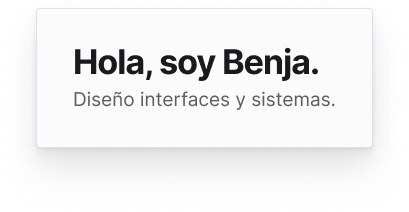

<!-- Generated by scripts/build-pages.mjs from figma/components.json. Do not edit by hand: change Figma, re-export, run `npm run build`. -->

# Paper note

**Level:** Molecule · **Variants:** 1 · **Figma:** [open component](https://www.figma.com/design/FvaEDyROUUsM8ntHj8C9f8/?node-id=1189-41)

## Description

Lienzo · Nota de papel para títulos de sección en el canvas (Hola / Proyectos). Rotar +2° a +4° en la instancia. Título: aplicar typography/heading/xl (Axiforma) en archivo local.

## Properties

| Property | Type | Values / default |
| --- | --- | --- |
| Title | Text | `Hola, soy Benja.` |
| Subtitle | Text | `Diseño interfaces y sistemas.` |

## Tokens

Styled only with tokens from [`tokens.css`](../tokens.css). See [foundations](../foundations/README.md).

## Preview

