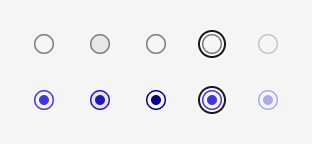

<!-- Generated by scripts/build-pages.mjs from figma/components.json. Do not edit by hand: change Figma, re-export, run `npm run build`. -->

# Radio button

**Level:** Atom · **Variants:** 10 · **Figma:** [open component](https://www.figma.com/design/FvaEDyROUUsM8ntHj8C9f8/?node-id=1139-217)

## Description

Reusable Radio_button with portfolio foundations and Phosphor. Design only; no interactive prototype or production behavior claimed.

## Properties

| Property | Type | Values / default |
| --- | --- | --- |
| Value | Variant | `Off` · `On` |
| State | Variant | `Default` · `Hover` · `Pressed` · `Focus` · `Disabled` |

## Tokens

Styled only with tokens from [`tokens.css`](../tokens.css). See [foundations](../foundations/README.md).

## Preview

