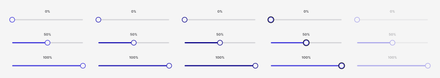

<!-- Generated by scripts/build-pages.mjs from figma/components.json. Do not edit by hand: change Figma, re-export, run `npm run build`. -->

# Slider

**Level:** Atom · **Variants:** 15 · **Figma:** [open component](https://www.figma.com/design/FvaEDyROUUsM8ntHj8C9f8/?node-id=1139-376)

## Description

Reusable Slider with portfolio foundations and Phosphor. Design only; no interactive prototype or production behavior claimed.

## Properties

| Property | Type | Values / default |
| --- | --- | --- |
| Value label 0 | Text | `0%` |
| Value label 50 | Text | `50%` |
| Value label 100 | Text | `100%` |
| Value | Variant | `0` · `50` · `100` |
| State | Variant | `Default` · `Hover` · `Pressed` · `Focus` · `Disabled` |

## Tokens

Styled only with tokens from [`tokens.css`](../tokens.css). See [foundations](../foundations/README.md).

## Preview

