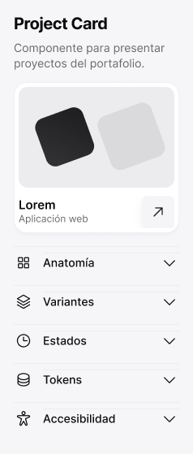

<!-- Generated by scripts/build-docs.mjs from figma/components.json, tokens.json and the Figma file. Do not edit. -->

# System · Component detail

> Pieza editable del sistema.

Parte del [Design System de Benjamín Abud](../README.md). Es un componente de Figma: sus props son las propiedades del componente en Figma y sus estilos salen solo de tokens. Los tokens se linkean como muestra [Primeros pasos](../foundations/getting-started.md). Todos los componentes: [Componentes](../COMPONENTS.md).

## Cómo usarlo

**Nivel:** Organismo · **Variantes:** 1 · **Figma:** [abrir el componente](https://www.figma.com/design/FvaEDyROUUsM8ntHj8C9f8/?node-id=868-1484)

**Variante por defecto:** el componente no tiene variantes.

## Props

| Prop | Tipo | Valores permitidos | Default | Descripción |
|---|---|---|---|---|
| `Title` | Texto | Cualquier texto | `Project Card` | — |
| `Description` | Texto | Cualquier texto | `Componente para presentar proyectos del portafolio.` | — |
| `Preview` | Instancia | Una instancia de icono | — | — |
| `Sections` | Slot | Instancias de componentes | — | — |

## Descripción en Figma

- Pieza editable del sistema.
- Sin acciones de prototipo.
- Fuente: Framer reviewPreview1 / reviewPreview2, 26 octubre 2026.

## Tokens

Todo lo que el componente tiene enlazado en Figma: variables, estilos de texto y de efecto. Valores en claro; la columna Oscuro y la nota Lienzo solo aparecen cuando el valor cambia.

| Token | Nivel | Valor | Oscuro | Para qué es |
|---|---|---|---|---|
| `--color-palette-white` | Primitivo | `oklch(100% 0 0)` | — | — |
| `--size-0` | Dimensión | `0px` | — | 0 px · escala base de Spacing |
| `--size-16` | Dimensión | `16px` | — | 16 px · escala base de Spacing |
| `--size-24` | Dimensión | `24px` | — | 24 px · escala base de Spacing |
| `--size-4` | Dimensión | `4px` | — | 4 px · escala base de Spacing |
| `--size-8` | Dimensión | `8px` | — | 8 px · escala base de Spacing |

### Variables fuera del sistema

- `button`
- `divider`
- `ink`
- `muted`

Estas variables están enlazadas en Figma pero no pertenecen a ninguna colección exportada. Hay que reemplazarlas por tokens del sistema.

## Vista previa

## Fuente

- El sistema entero como un documento Design System Doc Spec: [benjamin-abud-design-system.dsds.yaml](https://raw.githubusercontent.com/Baah07/benjamin-abud-design-system/main/benjamin-abud-design-system.dsds.yaml), donde este componente es la entrada `system-component-detail`
- Los componentes como datos: [components-api.json](https://raw.githubusercontent.com/Baah07/benjamin-abud-design-system/main/components-api.json)
- El inventario exportado de Figma: [figma/components.json](https://raw.githubusercontent.com/Baah07/benjamin-abud-design-system/main/figma/components.json)
- Los tokens: [tokens.json](https://raw.githubusercontent.com/Baah07/benjamin-abud-design-system/main/tokens.json)
- El nodo en Figma: [System · Component detail](https://www.figma.com/design/FvaEDyROUUsM8ntHj8C9f8/?node-id=868-1484)
