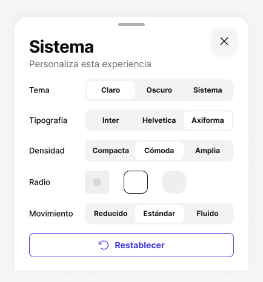

<!-- Generated by scripts/build-pages.mjs from figma/components.json. Do not edit by hand: change Figma, re-export, run `npm run build`. -->

# System · Mobile sheet

**Level:** Organism · **Variants:** 1 · **Figma:** [open component](https://www.figma.com/design/FvaEDyROUUsM8ntHj8C9f8/?node-id=868-1751)

## Description

Plantilla móvil común. Body es un slot: Personalize content (418 px total) o Component browser (756 px total). 386 px de ancho de referencia. El mismo contenido puede insertarse en sidebar. Sin prototipos ni variantes por selección.

## Properties

| Property | Type | Values / default |
| --- | --- | --- |
| Body | Slot | — |

## Tokens

Styled only with tokens from [`tokens.css`](../tokens.css). See [foundations](../foundations/README.md).

## Preview

