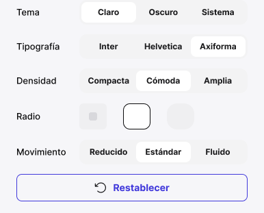

<!-- Generated by scripts/build-docs.mjs from figma/components.json, tokens.json and the Figma file. Do not edit. -->

# System · Personalize

> Pieza editable del sistema.

Parte del [Design System de Benjamín Abud](../README.md). Es un componente de Figma: sus props son las propiedades del componente en Figma y sus estilos salen solo de tokens. Los tokens se linkean como muestra [Primeros pasos](../foundations/getting-started.md). Todos los componentes: [Componentes](../COMPONENTS.md).

## Cómo usarlo

**Nivel:** Organismo · **Variantes:** 1 · **Figma:** [abrir el componente](https://www.figma.com/design/FvaEDyROUUsM8ntHj8C9f8/?node-id=868-1259)

**Variante por defecto:** el componente no tiene variantes.

## Descripción en Figma

- Pieza editable del sistema.
- Sin acciones de prototipo.
- Fuente: Framer reviewPreview1 / reviewPreview2, 26 octubre 2026.

## Tokens

Todo lo que el componente tiene enlazado en Figma: variables, estilos de texto y de efecto. Valores en claro; la columna Oscuro y la nota Lienzo solo aparecen cuando el valor cambia.

| Token | Nivel | Valor | Oscuro | Para qué es |
|---|---|---|---|---|
| `--border-primary` | Semántico | `oklch(47.17% 0.235 274.68)` | `oklch(66.85% 0.181 282.58)` | Borde de Button secondary. Light → indigo/600. Dark → indigo/600 (Primitives Dark): 6.3:1 sobre bg/surface/default, WCAG 2.2 SC 1.4.11. Antes indigo/300 en Dark (1.79:1). |
| `--radius-md` | Dimensión | `8px` | — | 8 px · radio documentado en Spacing |
| `--size-0` | Dimensión | `0px` | — | 0 px · escala base de Spacing |
| `--size-24` | Dimensión | `24px` | — | 24 px · escala base de Spacing |
| `--space-2` | Dimensión | `8px` | — | space-2 = 8 px. Fuente: columna Pixels de Spacing. |
| `--space-4` | Dimensión | `16px` | — | space-4 = 16 px. Fuente: columna Pixels de Spacing. |

## Vista previa

## Fuente

- El sistema entero como un documento Design System Doc Spec: [benjamin-abud-design-system.dsds.yaml](https://raw.githubusercontent.com/Baah07/benjamin-abud-design-system/main/benjamin-abud-design-system.dsds.yaml), donde este componente es la entrada `system-personalize`
- Los componentes como datos: [components-api.json](https://raw.githubusercontent.com/Baah07/benjamin-abud-design-system/main/components-api.json)
- El inventario exportado de Figma: [figma/components.json](https://raw.githubusercontent.com/Baah07/benjamin-abud-design-system/main/figma/components.json)
- Los tokens: [tokens.json](https://raw.githubusercontent.com/Baah07/benjamin-abud-design-system/main/tokens.json)
- El nodo en Figma: [System · Personalize](https://www.figma.com/design/FvaEDyROUUsM8ntHj8C9f8/?node-id=868-1259)
