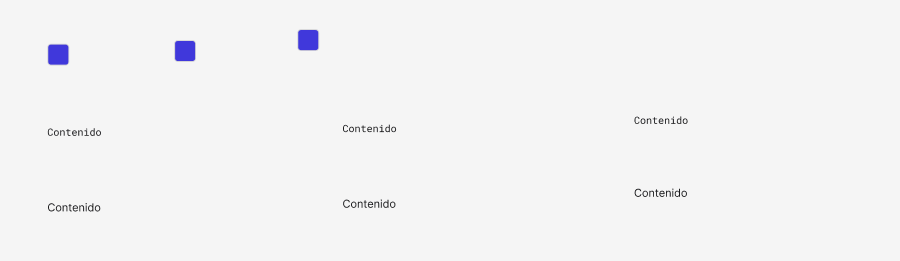

<!-- Generated by scripts/build-docs.mjs from figma/components.json, tokens.json and the Figma file. Do not edit. -->

# Table cell

> Reusable Table_cell with portfolio foundations and Phosphor.

Parte del [Design System de Benjamín Abud](../README.md). Es un componente de Figma: sus props son las propiedades del componente en Figma y sus estilos salen solo de tokens. Los tokens se linkean como muestra [Primeros pasos](../foundations/getting-started.md). Todos los componentes: [Componentes](../COMPONENTS.md).

## Cómo usarlo

**Nivel:** Átomo · **Variantes:** 9 · **Figma:** [abrir el componente](https://www.figma.com/design/FvaEDyROUUsM8ntHj8C9f8/?node-id=1145-242)

**Variante por defecto:** Role = `Preview`, Layout = `Desktop`

## Props

| Prop | Tipo | Valores permitidos | Default | Descripción |
|---|---|---|---|---|
| `Preview` | Instancia | Una instancia de icono | — | — |
| `Content` | Texto | Cualquier texto | `Contenido` | — |
| `Role` | Variante | `Preview`, `Code`, `Text` | `Preview` | — |
| `Layout` | Variante | `Desktop`, `Tablet`, `Mobile` | `Desktop` | — |

## Variantes

Variantes disponibles: 9, combinando `Role`, `Layout`.

- **Role:** `Preview`, `Code`, `Text`
- **Layout:** `Desktop`, `Tablet`, `Mobile`

## Descripción en Figma

- Reusable Table_cell with portfolio foundations and Phosphor.
- Design only; no interactive prototype or production behavior claimed.

## Tokens

Todo lo que el componente tiene enlazado en Figma: variables, estilos de texto y de efecto. Valores en claro; la columna Oscuro y la nota Lienzo solo aparecen cuando el valor cambia.

| Token | Nivel | Valor | Oscuro | Para qué es |
|---|---|---|---|---|
| `--size-12` | Dimensión | `12px` | — | 12 px · escala base de Spacing |
| `--size-16` | Dimensión | `16px` | — | 16 px · escala base de Spacing |
| `--size-20` | Dimensión | `20px` | — | — |
| `--text-on-surface` | Semántico | `oklch(22.01% 0.004 288.39)` | `oklch(97.08% 0.003 288.66)` | On Surface · Frame Tonal palettes · Light Theme · Dark Theme. Light → neutral/900 (Primitives Light). Dark → neutral/950 (Primitives Dark). Usar el mismo modo en ambas colecciones. |

### Variables fuera del sistema

- `documentation/table/body`
- `documentation/table/code`

Estas variables están enlazadas en Figma pero no pertenecen a ninguna colección exportada. Hay que reemplazarlas por tokens del sistema.

## Vista previa

## Fuente

- El sistema entero como un documento Design System Doc Spec: [benjamin-abud-design-system.dsds.yaml](https://raw.githubusercontent.com/Baah07/benjamin-abud-design-system/main/benjamin-abud-design-system.dsds.yaml), donde este componente es la entrada `table-cell`
- Los componentes como datos: [components-api.json](https://raw.githubusercontent.com/Baah07/benjamin-abud-design-system/main/components-api.json)
- El inventario exportado de Figma: [figma/components.json](https://raw.githubusercontent.com/Baah07/benjamin-abud-design-system/main/figma/components.json)
- Los tokens: [tokens.json](https://raw.githubusercontent.com/Baah07/benjamin-abud-design-system/main/tokens.json)
- El nodo en Figma: [Table cell](https://www.figma.com/design/FvaEDyROUUsM8ntHj8C9f8/?node-id=1145-242)
