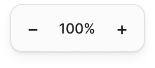

<!-- Generated by scripts/build-pages.mjs from figma/components.json. Do not edit by hand: change Figma, re-export, run `npm run build`. -->

# Zoom control

**Level:** Molecule · **Variants:** 1 · **Figma:** [open component](https://www.figma.com/design/FvaEDyROUUsM8ntHj8C9f8/?node-id=1189-48)

## Description

Lienzo · Control de zoom del canvas (esquina inferior izquierda). Acompañar con Filter chip "Ordenar" + icono list.

## Properties

| Property | Type | Values / default |
| --- | --- | --- |
| Zoom | Text | `100%` |

## Tokens

Styled only with tokens from [`tokens.css`](../tokens.css). See [foundations](../foundations/README.md).

## Preview

